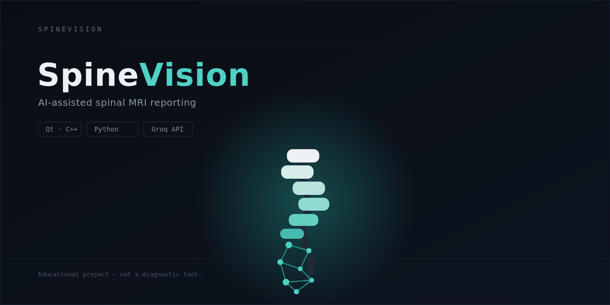

https://github.com/user-attachments/assets/f95636e3-dd81-4694-bc66-c6c787f2d03e


<p align="center">
  
</p>

<h1 align="center">🧠 SpineVision AI</h1>

<p align="center">
AI-Powered Spinal MRI Analysis using C++, Qt & Python
</p>

# SpineVision-AI
SpineVision AI is a desktop app demonstrating C++ (Qt) frontend integration with a Python AI backend using QProcess (no servers/databases). Users upload MRIs and notes; the app passes data to a vision LLM via Groq API to return structured radiology-style reports. Built as an educational pattern, not a diagnostic tool!!
# SpineVision AI 🩺

SpineVision AI is a desktop application that demonstrates how a traditional C++ desktop frontend can be integrated with a modern AI backend to produce structured, readable output from unstructured medical imaging and clinical text.

## 🚀 Features
* **Native C++ Frontend:** Built entirely in Qt Creator for a smooth, responsive desktop user interface.
* **Process-Based Communication:** Uses `QProcess` to easily connect the Qt frontend to a Python subprocess without heavy databases or servers.
* **AI-Powered Analysis:** Leverages a vision-capable LLM via the **Groq API** to process MRI images and clinical notes.
* **Structured Output:** Automatically formats raw AI responses into clean, professional, radiology-style reports.
  
# 📖 Tutorial

Getting started with **SpineVision AI** is simple.

---

# 🚀 Step 1 – Clone the Repository

```bash
git clone https://github.com/yourusername/SpineVision-AI.git
```

Open the project in **Qt Creator**.

---

# 📦 Step 2 – Install Python Dependencies

Navigate to the Python folder and install all required packages.

```bash
pip install -r requirements.txt
```

---

# 🔑 Step 3 – Configure Your API Key

The project already contains a `.env` file.

Open the `.env` file and replace the placeholder API key with your own **Groq API Key**.

Example:

```env
GROQ_API_KEY=your_api_key_here
```

Get your API key here:

https://console.groq.com/keys
---
# 📍 Step 4 – Update the Python Script Path

Open:

```cpp
main.cpp
```

Locate the path pointing to **main.py**.

Example:

```cpp
QString pythonScript =
"C:/Users/YourName/Documents/SpineVision-AI/python/main.py";
```

Replace it with the location of **main.py** on your computer.

Example:

```cpp
QString pythonScript =
"D:/Projects/SpineVision-AI/python/main.py";
```

---

# ▶️ Step 5 – Run the Application

Build the Qt project.

Click **Run** inside Qt Creator.

The application will launch.

---

# 🩻 Step 6 – Upload an MRI Image

Click

**📂 Upload MRI**

Select a spine MRI image.

Supported formats:

- JPG
- JPEG
- PNG

---

# 📝 Step 7 – Enter Patient Notes (Optional)

You may provide additional clinical information.

Example:

- Lower back pain
- Leg numbness
- Previous surgery
- Difficulty walking

These notes are used as additional context for the AI.

---

# 🧠 Step 8 – Analyze MRI

Click

**Analyze MRI**

The application will:

- Load the MRI image
- Send the image to the AI model
- Process the scan
- Generate a structured report

---

# 📄 Step 9 – Review the AI Report

The generated report contains:

- Findings
- Clinical Observations
- Impression
- Recommendations

---

# 🎥 Demo

Watch the project in action.

*(Insert your LinkedIn or YouTube demo video here.)*

---

# 🛠 Tech Stack

- C++
- Qt Framework
- Python
- Groq Vision API
- QProcess
- dotenv

---

# 🧩 Project Workflow

```
             User
               │
               ▼
      Upload MRI Image
               │
               ▼
      Qt Desktop Application
               │
               ▼
      Python Backend (main.py)
               │
               ▼
      Groq Vision API
               │
               ▼
      AI MRI Analysis
               │
               ▼
      Structured Medical Report
```

---

# ⚠ Disclaimer

SpineVision AI is an educational project created for learning and demonstration purposes.

It is **NOT** a certified medical device and **must not** be used for clinical diagnosis or treatment decisions.

Always consult a qualified radiologist or healthcare professional.

---

If you found this project useful, consider giving it a ⭐ on GitHub!


